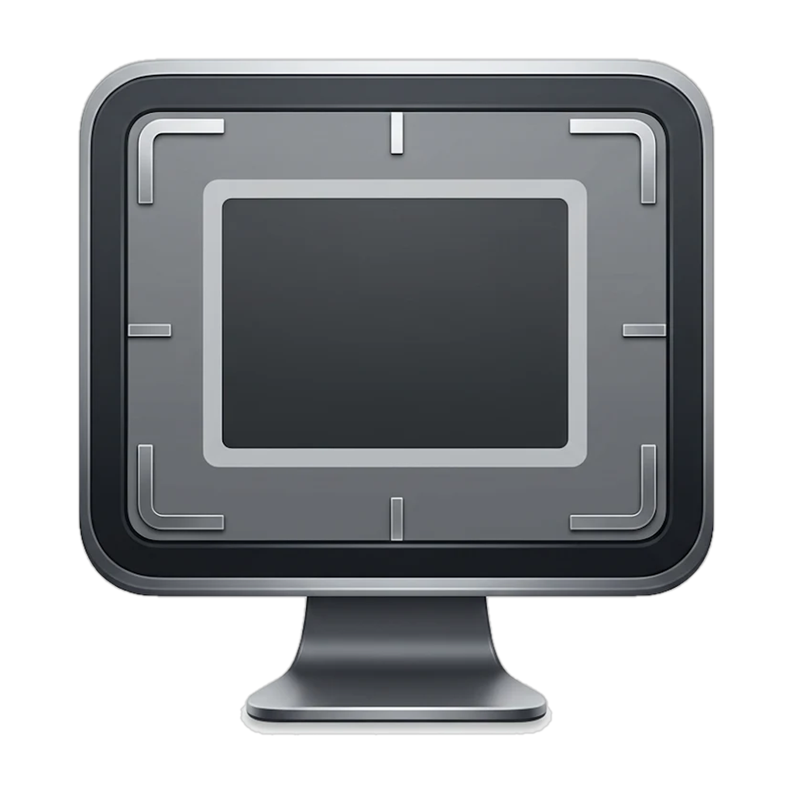

<p align="center">
  
</p>

<h1 align="center">UsableDisplay</h1>

<p align="center">
  A small macOS menu bar app that lets you use only the <em>working part</em> of a display with dead pixels, or make a big screen behave like a smaller one.
</p>

---

## What it does

Got a dead row of pixels along the edge of your OLED TV or monitor? UsableDisplay hides it behind a black border and makes macOS treat the rest of the screen as the whole desktop, so the menu bar, Dock and windows never go under the damaged area.

It can also emulate a **smaller screen** on a larger panel. For example, it can make a 48″ TV behave like a 24″ or 40″ monitor by changing a number.

It was built for an LG C1 48″ (3840×2160) on an M4 Mac mini running macOS 15 with a 16 px dead strip at the top. It should work with any display macOS can drive.

## How it works

macOS has no built-in underscan for HDMI displays, and a black bar drawn on top of the screen doesn't change the usable desktop area. UsableDisplay does this instead:

1. It creates a **virtual display** at the usable size (the panel size minus your borders).
2. It makes the virtual display your main display, so the menu bar, Dock and new windows land there.
3. It captures the virtual display with **ScreenCaptureKit**.
4. It shows that capture in a borderless, black, full-screen window on the physical display. The window is offset by your border sizes, so the black frame covers the dead pixels.

## Features

- Border size in physical pixels for each edge (top, bottom, left, right).
- Optional **screen size mode**: enter the diagonal you want (24″, 40″ and so on) and the image is scaled and centered.
- Aspect ratio: keep your screen's own shape automatically, or turn that off and pick any ratio (16:9, 16:10, 4:3, 21:9, custom, or none).
- HiDPI (2×) or 1× virtual screen, and 30, 60 or 120 Hz refresh.
- Live summary of the resulting virtual resolution and position.
- Menu bar app with Enable/Disable, Re-apply and Launch at Login.
- Re-applies itself when the display disconnects and reconnects, for example after the TV is power-cycled.
- Settings are saved between launches. Nothing is hard-coded to one monitor.

## Requirements

- macOS 14 or later (developed and tested on macOS 15)
- Apple silicon or Intel Mac
- Xcode Command Line Tools (`xcode-select --install`). Full Xcode isn't needed.

## Build

```bash
git clone <this repo>
cd UsableDisplay
./build.sh
open UsableDisplay.app
```

`build.sh` compiles `main.swift` with `swiftc`, generates the app icon from `AppIcon-1024.png`, bundles `MenuIcon.png`, and ad-hoc signs the result. To keep the app, move `UsableDisplay.app` to `/Applications`.

## First run

1. Open the app. A monitor icon appears in the menu bar.
2. macOS asks for **Screen Recording** permission. Enable it under *System Settings → Privacy & Security → Screen & System Audio Recording*.
3. Choose **Re-apply** from the menu bar icon.
4. Open **Settings…**, enter your border sizes and press **Apply**.

Because the build is ad-hoc signed, macOS may ask for the permission again after you rebuild.

## Usage

| Setting | Meaning |
|---|---|
| **Display** | Which physical display to work on. |
| **Real panel diagonal** | Actual size of your screen in inches. Only used for the inch conversion. |
| **Mode: Border pixels** | The image fills the panel minus the borders you set. |
| **Mode: Screen size** | The image is scaled to look like a screen of the given diagonal and centered. Borders still reserve the dead area. |
| **Top / Bottom / Left / Right** | Pixels kept black on each edge of the physical panel. |
| **Keep screen aspect ratio** | On: the image keeps your screen's own shape (the ratio picker is disabled). Off: pick any ratio below. Extra black is added on the other edges as needed. |
| **HiDPI (2×)** | Sharper UI that looks half the pixel size. Turn it off for small emulated sizes, where a HiDPI UI looks very large. |
| **Refresh rate** | Refresh rate of the virtual screen. |

**Example (LG C1 48″, 16 px dead strip at the top):** set Top to 16 and leave the other sides at 0. With "Keep screen aspect ratio" on, this gives a 3808×2144 virtual screen.

## Known limitations

- **Private API.** The virtual display uses `CGVirtualDisplay`, an undocumented CoreGraphics interface (the same one used by tools like BetterDisplay and DeskPad). A future macOS update could break it.
- **Slight overhead.** Capturing and redrawing adds roughly a frame of latency and some GPU use. It's fine for desktop work but not ideal for fast games.
- **Cursor.** The physical display is placed diagonally off the virtual one, touching only at a corner, so the cursor rarely wanders onto the black overlay. It can still happen at the exact corner.
- **Other screens.** DRM-protected video may show as black in a capture, depending on the app.

## Troubleshooting

- **Nothing happens, or the screen stays black.** Check the Screen Recording permission, then choose **Re-apply**. To see the app's log, run `log stream --predicate 'eventMessage CONTAINS "UsableDisplay"'`.
- **Stuck overlay.** Choose **Quit** from the menu bar icon, or run `pkill UsableDisplay`.
- **Ghosting or double images on the TV.** Turn off motion processing on the TV (on LG OLED: TruMotion / Motion Eye Care and OLED Motion Pro), and use Game or PC mode.
- **Green screen (or a nameless 1080p display afterwards) when the virtual screen is built.** Changing the display layout can make the HDMI link retrain, and a marginal link (for example 4K at 120 Hz over a long or non-certified cable) may fail to lock again. Set the display to **60 Hz** in System Settings → Displays before using the app, use a certified Ultra High Speed HDMI cable, and unplug and replug the cable to recover. The log (`log show --last 5m --predicate 'process == "UsableDisplay"'`) shows each stage.
- **Display "lost" right after the virtual screen is created.** macOS hides a display that is mirroring another one from apps, so a TV that was put into a mirror set looks like it vanished. The app now logs every display (including mirror state) and switches mirroring off. The virtual display gets a new identity on every start so macOS cannot re-apply an old saved layout.
- **Icon doesn't update after a rebuild.** Run `killall Finder` and `killall Dock`.
- **Interface looks too large.** Turn HiDPI off in Settings.

## Safety features

- **No automatic retry loops.** If setting up the virtual screen fails, the app stops and shows the reason in its menu. It does not try again on its own.
- **Start delay.** At login and after waking from sleep, the app waits (10 s by default, configurable) and checks that the physical display is really present before building anything.
- **Display readiness check.** Before building anything, the app waits until the physical display reports a stable resolution. After adding the virtual screen it waits for the display to come back at the same resolution (the TV may need a few seconds to re-lock its signal) and finds it again by UUID, because display IDs can change.
- **Resolution check.** The app remembers the panel resolution your settings were applied at. If an automatic start finds a different resolution, it does not build the virtual screen. Open Settings and press **Apply** to confirm the new resolution.
- **Login timing.** At login the app waits for the Dock and Finder to be running, then for the display's resolution, refresh rate and HDR state to stay unchanged for 6 seconds. The login delay (30 s by default) and the wake delay are configurable, and automatic start can be turned off entirely.
- **Setup stages (Troubleshooting).** Setup can be stopped after the virtual display, after the display layout, or after the black overlay, to find which step upsets a particular display or cable.
- **Display selection.** Displays without a UUID (half-connected or virtual displays from other tools) are ignored, and "Automatic" picks the display with the most pixels. You can also choose a specific display in Settings. Every start logs the list of displays it can see.
- **Sleep and wake.** The virtual screen is removed before the Mac sleeps and rebuilt after it wakes.
- **Interrupted-start guard.** If a start fails, crashes or is cut short (for example by a forced power-off), the app will not start automatically next time. Choose **Re-apply** to start it again.
- **Restore Displays (emergency)** in the menu removes the virtual screen and restores macOS's saved display layout.

## Recovering from a green or blank screen

If the display shows a green screen or no picture, for example after a forced reboot, you can recover it from another computer (SSH or remote desktop) or in Safe Mode:

1. Stop the app and keep it from launching: `pkill UsableDisplay`, then remove it under *System Settings → General → Login Items & Extensions* (or move `UsableDisplay.app` to the Trash).
2. Reset the saved display layout, then reboot:
   ```bash
   sudo rm -f /Library/Preferences/com.apple.windowserver.displays.plist
   rm -f ~/Library/Preferences/ByHost/com.apple.windowserver.displays.*.plist
   sudo reboot
   ```
   This resets display arrangement and resolution choices for all your displays.
3. If it persists, unplug and replug the HDMI cable (or try another port), and check the TV's HDMI signal settings.

To start in Safe Mode on an Apple silicon Mac: shut down, press and hold the power button until "Loading startup options" appears, select your disk, hold Shift, and click "Continue in Safe Mode". Login items don't run in Safe Mode.

## Project layout

```
main.swift          App source (UI, virtual display, capture, overlay)
Bridging.h          Declarations for the private CGVirtualDisplay API
Info.plist          App bundle metadata (menu bar app, no Dock icon)
build.sh            Build script (compile, icons, sign)
AppIcon-1024.png    App icon source
MenuIcon.png        Menu bar template icon (@3x)
```

## Privacy

UsableDisplay never sends anything over the network. It captures only its own virtual display, and only to draw it on your physical display. Settings are stored locally in `UserDefaults`.

## Contributing

Issues and pull requests are welcome. Tested configurations (display model, Mac model, macOS version) are especially useful.

## License

Add your license here (for example MIT) and include a `LICENSE` file.
